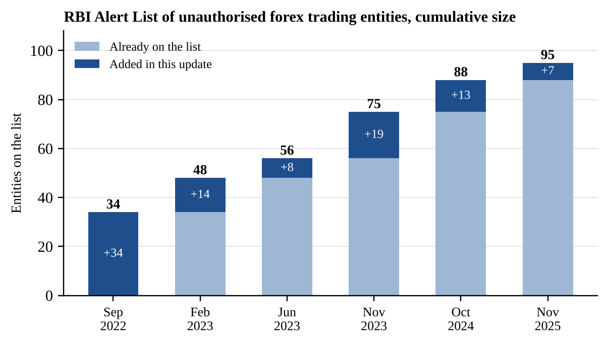

# Assessing India's Forex Trading Regulations: Challenges and the Need for Reform

**Policy research project** · Bhargava C · May 2025, revised October 2026

> **Start here:** [4-page policy brief (PDF)](policy-brief/Forex_Policy_Brief.pdf) · [Full report (PDF, 30 pages)](report/Forex_Regulations_Report.pdf)

## Research question

Are India's forex trading regulations effective in keeping residents' retail currency trading within legal, supervised channels, and what reform would best close the gap?

## Summary

Indian residents may trade currencies legally only through exchange-traded contracts in a few currency pairs, which are meant mainly for hedging. Overseas platforms nevertheless continue to market restricted products to Indian users. This project reviews India's legal framework (FEMA, 1999 and RBI and SEBI rules) and adds two pieces of evidence compiled for the study. The first is the growth of the RBI Alert List of unauthorised forex entities. The second compares retail forex rules in India, the UK, the US and Australia. It recommends combining stronger enforcement with a narrow, supervised legal channel on Indian exchanges.

## Key findings

1. **The problem has persisted.** The RBI Alert List grew from **34 entities (September 2022) to 95 (November 2025)**, an increase of 179%. Most additions came in 2023 (41), and fewer in 2024 (13) and 2025 (7).
2. **India is the outlier.** The UK, US and Australia allow retail forex trading but limit the damage. They cap leverage at 30:1 to 50:1 on major pairs and require margin close-out, negative balance protection and loss disclosure. India offers no legal channel for retail currency speculation.
3. **Recommendation.** Keep enforcing the rules and open a small, supervised channel. This means SEBI-registered brokers on Indian exchanges, a few liquid pairs, strict leverage limits and published loss rates, reviewed against data on participation and client losses.

## Repository contents

| Path | Contents |
|---|---|
| `policy-brief/Forex_Policy_Brief.pdf` (`.docx`) | 4-page policy brief: problem, evidence, options, recommendation |
| `report/Forex_Regulations_Report.pdf` (`.docx`) | Full report: abstract, research question, methodology, five chapters, conclusion, references |
| `data/rbi_alert_list_updates.csv` | Compiled dataset of RBI Alert List updates (see below) |
| `figures/rbi_alert_list_growth.png` | Chart of the dataset |

## Data: `rbi_alert_list_updates.csv`

| Column | Meaning |
|---|---|
| `update_date` | Date of the Alert List update (YYYY-MM-DD) |
| `entities_added` | Entities added in that update |
| `cumulative_total` | Total entities on the list after the update |
| `total_basis` | `stated` if the source gives the total; `derived` if calculated (October 2024: 75 + 13) |
| `source` | Where the figures were taken from (full references in the report) |

The list counts entities that the RBI has identified and named. It does **not** measure how many Indians trade offshore or how much money is involved.

## Methodology

This is a qualitative policy analysis based on published sources, carried out in three steps:

1. **Document review** of FEMA, 1999, RBI press releases, circulars and Master Directions, and FCA, CFTC and ASIC rules.
2. **Data compilation** of every RBI Alert List update from RBI press releases and news reports.
3. **Comparative and options analysis.** Four jurisdictions were compared on five points, then three policy options were assessed for investor protection, financial stability and enforceability.

## Limitations

- No primary data, such as surveys of traders, were collected, and there is no public data on the number of offshore traders or their losses.
- Most Alert List totals come from news reports of RBI updates, and later revisions or removals may be missed.
- Regulations change, so check each rule against the current regulator text before citing it. The data run to November 2025.

## Disclaimer

This is an independent academic project based on publicly available sources. It is **not legal, financial or investment advice**. Mentioning a trading platform does not mean it is illegal. What Indian rules restrict is residents using such platforms to trade currency pairs or contracts that are not permitted in India.

## Note on tools

AI tools (ChatGPT and Claude) were used for drafting support, editing. 

## Licence

The text, data and figures are licensed under [Creative Commons Attribution 4.0 International (CC BY 4.0)](https://creativecommons.org/licenses/by/4.0/). See `LICENSE`.

## Citation

Bhargava C. (2026). *Assessing India's forex trading regulations: Challenges and the need for reform* (Policy research project, revised October 2026). GitHub.
